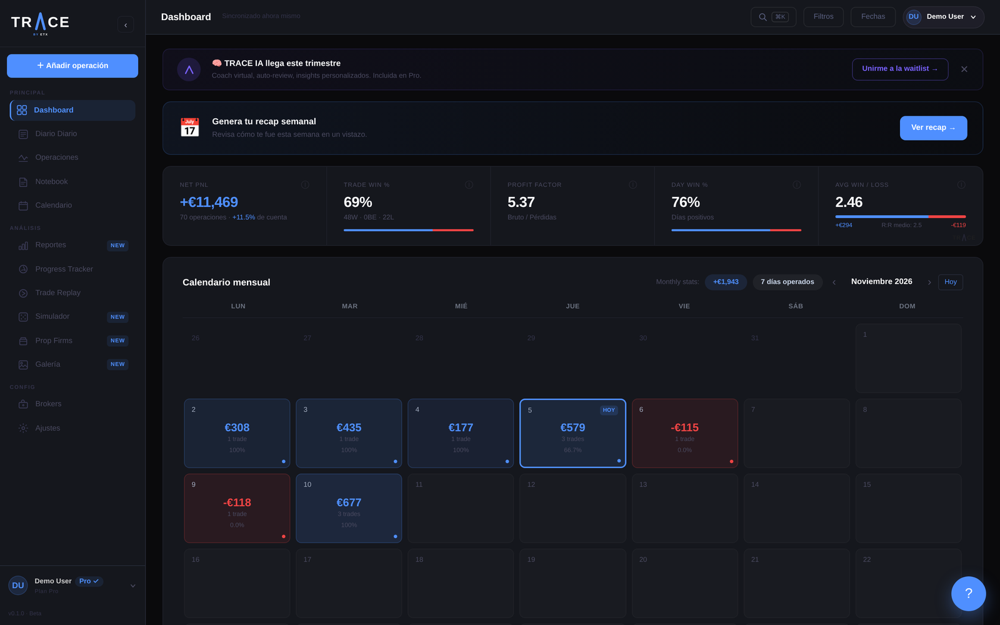
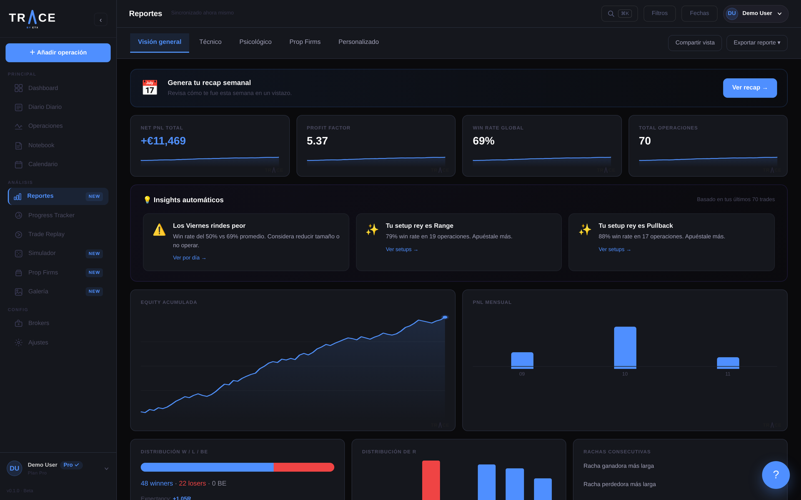
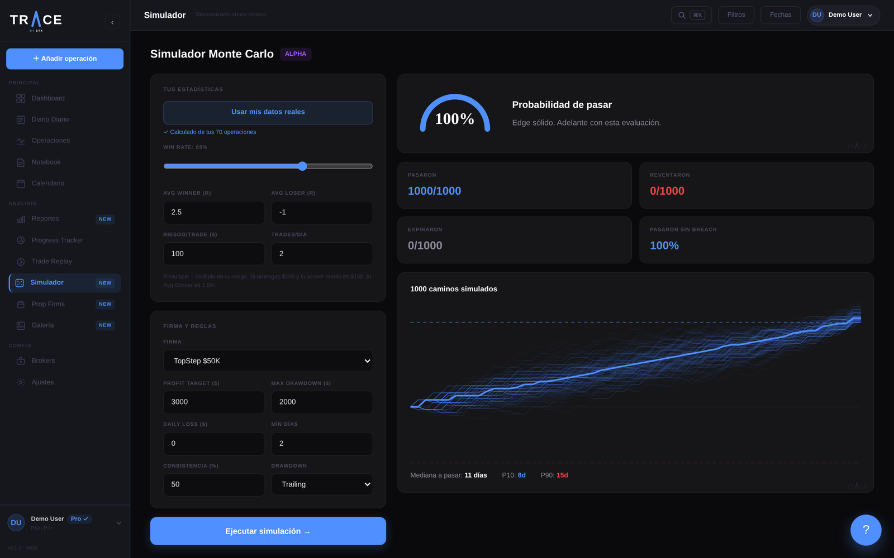
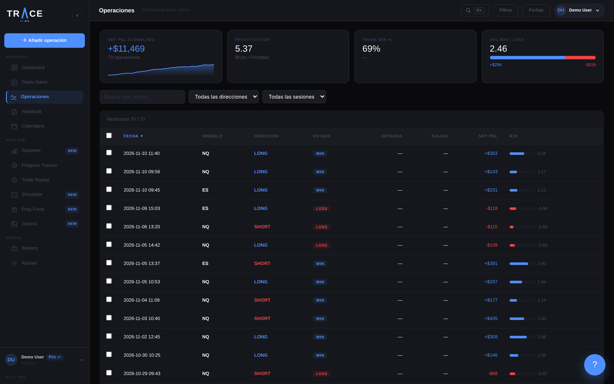
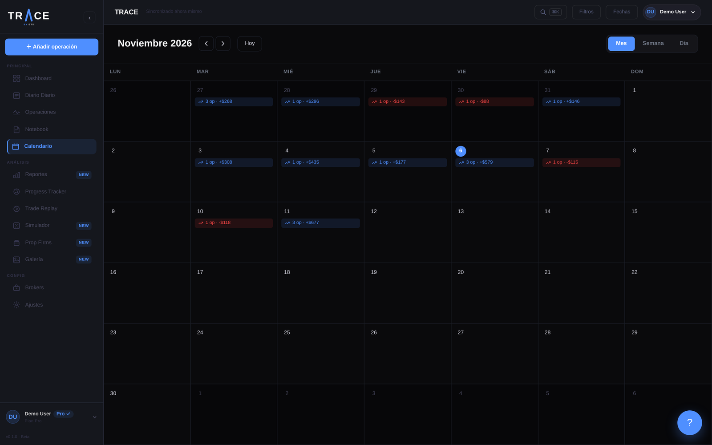

# TRACE by ETX

**A performance journal and analytics platform for active traders and investors.** Log every position, then let TRACE show you where your results actually come from: which setups, sessions, days and habits make money, and which ones cost it.

Designed, branded and built solo by [Erik Heffermehl](https://github.com/ErikSchiller).

**Live demo:** [trace-by-etx.vercel.app](https://trace-by-etx.vercel.app) (the UI is in Spanish)



## Features

- **Dashboard:** net P&L, win rate, profit factor, average win/loss and a monthly P&L calendar.
- **TRACE Score:** a 0–100 score across six dimensions (win rate, profit factor, discipline, consistency, risk:reward, habits), with a breakdown of how each one is calculated.
- **Reports with automatic insights:** a rule-based insight engine that finds patterns in your data, for example "you underperform on Fridays" or "your best setup is Range", and links you to the positions behind each one.
- **Monte Carlo simulator:** runs 1,000 simulated evaluation paths from your real stats. It models trailing or static drawdown, daily loss limits, consistency rules and minimum days, then reports pass probability, median days to pass and P10/P90.
- **Positions table:** filtering, sorting, bulk actions and undo.
- **Calendar, notebook, daily journal, progress tracker and replay tool.**
- **Free / Pro plans** with feature gating (`usePlan` + a `ProLock` component), an upgrade flow and pricing pages.
- **Marketing site** with legal pages written to comply with EU GDPR (RGPD) and Spanish e-commerce law (LSSI-CE).
- **i18n:** Spanish first, with an English translation layer in progress (i18next).

| Reports and insights | Monte Carlo simulator |
| --- | --- |
|  |  |

| Positions | Calendar |
| --- | --- |
|  |  |

## Tech stack

| Layer | Tools |
| --- | --- |
| Frontend | React 19, TypeScript, Vite |
| State | Zustand (persisted stores) |
| Styling | Tailwind CSS 4, custom design system (Space Grotesk + Syne) |
| Charts | Recharts plus hand-rolled SVG |
| Routing / i18n | React Router 7, i18next |
| Storage | localStorage for app data, IndexedDB for screenshots |
| Deploy | Vercel, auto-deploy on every push to `main` |

## Architecture

```
src/
├── pages/        Route-level screens (Dashboard, Reports, Simulator, Trades, ...)
├── components/   Feature components (Charts, TradeForm, Analytics, Notebook, ...)
├── store/        Zustand stores, one per domain (trades, auth, notebook, prop firms, goals, ...)
├── utils/        Pure logic: monteCarlo, traceScore, insightEngine, calculations, export
├── config/       Plans, presets, social links
├── i18n/         ES / EN translations
└── types/        Shared TypeScript types
```

Calculation logic is kept in pure functions in `utils/`, separate from the UI. That makes it easy to test and to reuse in charts, reports and generated P&L cards. Screenshots attached to positions are stored in IndexedDB rather than localStorage, so they don't hit the localStorage quota.

## Run locally

```bash
npm install
npm run dev      # http://localhost:5173
npm run build    # type-check + production build
```

## Status and roadmap

TRACE is in beta. The frontend is feature-complete. Accounts and data currently live in the browser (localStorage), and the local auth is a placeholder for development only.

Next on the roadmap:

- [ ] Supabase backend: Postgres, Supabase Auth and row-level security (schema drafted)
- [ ] Stripe subscriptions for the Pro plan
- [ ] Transactional email via Resend
- [ ] Code splitting to reduce the main bundle size
- [ ] Unit tests for `utils/` (Monte Carlo, TRACE Score, insights)

## License

© Erik Heffermehl. All rights reserved. The source is public for portfolio and review purposes.
